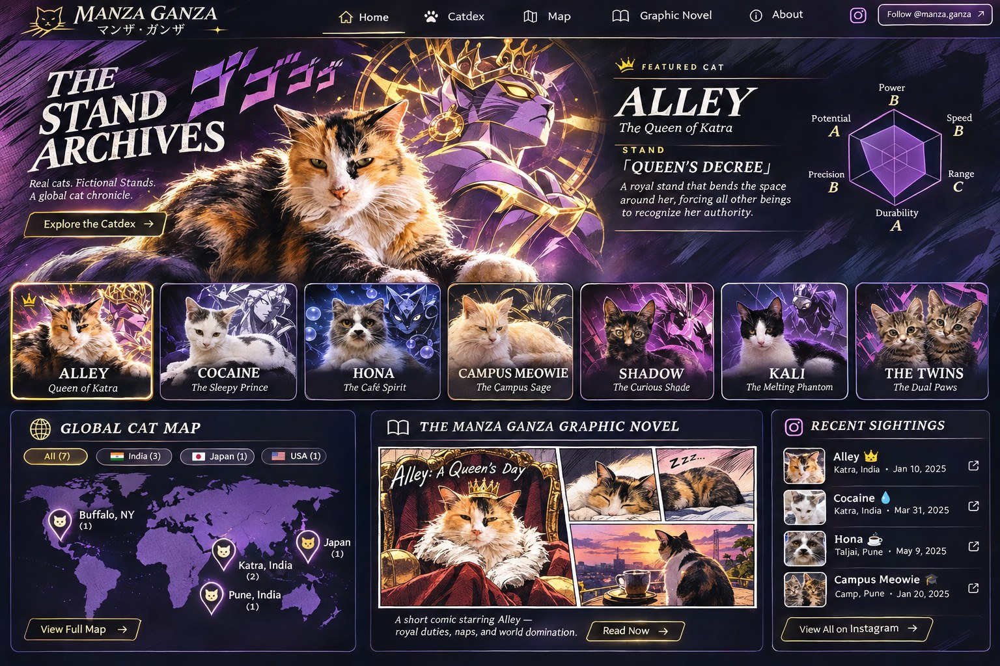

# MANZA GANZA · The Stand Archives

**A complete, static, responsive website for GitHub Pages.** Real cat photos from the screenshots you provided, fictional Stand character files, interactive global map, illustrated short comic starring Alley, local Cat Studio for adding cats, and an optional official Instagram API synchronization workflow.

**Official domain:** `https://manza.rohanmarar.com/`  
**Instagram:** `https://www.instagram.com/manza.ganza/`



## 1. Launch in five minutes

1. Unzip the package into a folder. You should see `index.html`, `styles.css`, `app.js`, `data/`, `assets/`, `.github/`, and `CNAME` at the **root**.
2. Create a **new GitHub repository**, e.g. `manza-ganza` (public is easiest for GitHub Pages). Or copy the files into your existing website repository after backing it up.
3. Upload all files and folders, **including `.github/workflows/deploy.yml`**. If using the web uploader, GitHub may hide dotfolders locally; the CLI method below is reliable.
4. In GitHub: **Settings → Pages → Build and deployment → Source: GitHub Actions.** The included workflow deploys on pushes to `main`.
5. Under **Settings → Pages → Custom domain**, enter `manza.rohanmarar.com` and save. In your DNS (e.g. Cloudflare), add:

   | Type | Name | Target | Proxy |
   |------|------|--------|-------|
   | CNAME | `manza` | `YOUR_GITHUB_USERNAME.github.io` | DNS only during initial setup |

   Replace `YOUR_GITHUB_USERNAME` with your real GitHub username, **without the repository name**. Remove any older conflicting DNS record for the `manza` subdomain. After GitHub issues a certificate, select **Enforce HTTPS**. **Add the domain in GitHub first, then DNS**, to avoid subdomain-takeover issues. DNS/certificate activation can take time. Your existing `rohanmarar.com` remains unchanged.

### Recommended git commands (Mac Terminal)

```bash
cd /path/to/unzipped/manza-ganza
# If using a NEW empty GitHub repository:
git init
git add .
git commit -m "Launch Manza Ganza: The Stand Archives"
git branch -M main
git remote add origin https://github.com/YOUR_GITHUB_USERNAME/manza-ganza.git
git push -u origin main
```

**If the destination repository already has files**, don't blindly reinitialize or overwrite its history. Copy the site's files into that repo, then `git add . && git commit -m "Redesign Manza Ganza" && git push`.

### Preview on your Mac before deployment

```bash
cd /path/to/manza-ganza
python3 -m http.server 8000
```

Visit `http://localhost:8000/`. Don't open `index.html` via `file://`; the browser blocks local JSON fetches in that mode. The map needs an Internet connection for tiles (CARTO/OpenStreetMap), and Google Fonts need Internet as well (system fallbacks included).

## 2. What's included

- `index.html`, `styles.css`, `app.js`: no-framework responsive website, mobile menu, featured cat selection, Stand radar chart, search, filters, shareable cat character dossiers (`#cat/alley`).
- `data/cats.json`: the **source of truth** for all character profiles, locations, abilities, stats, and photos.
- `assets/cats/`: cleaned crops of **your uploaded Instagram screenshots**. You should eventually replace these with the original full-resolution cat photos for best quality.
- `assets/stands/`: stand-themed concept portraits cropped from the design mockup you approved. These are **fictional illustration concepts** and may differ from the exact real cat markings.
- `assets/art/`: original-looking illustrative Alley concept panels, hero art, and social sharing image from the approved generated mockup.
- `studio.html`, `studio.js`: **Cat Studio**, a no-login local editor for generating an updated `cats.json` and an optimized WebP of a new cat.
- `data/instagram.json`: recent public Instagram media, initially empty. The site displays curated existing cats until official synchronization is enabled.
- `scripts/sync_instagram.py` and `.github/workflows/deploy.yml`: optional authorized official Instagram feed sync, plus static deployment.

## 3. Add a cat quickly (the intended routine)

1. Go to **`manza.rohanmarar.com/studio.html`** (or localhost `/studio.html`).
2. Enter the cat's name, title, location, behavior, Stand, abilities, and a photo. Click the map to pick a **general area**, not the exact position of a vulnerable cat or person's residence.
3. Click **Prepare files** → **Download cats.json** and **Download cat photo**.
4. In the GitHub repository, replace `data/cats.json` with the downloaded version. Add the new `.webp` into `assets/cats/`. Commit them. GitHub Pages redeploys automatically.

The Studio is **not an online database**: its downloads must be committed. This is deliberate for a low-cost static hosting arrangement. **Do not publish a page claiming that a submitted sighting is live until committed.** If the two of you edit simultaneously, start from the latest repository version, to avoid conflicts.

### Direct JSON editing

You can instead duplicate an entry in `data/cats.json`, change its `id` (unique lowercase kebab-case), `number` (unique displayed number), `name`, `photo`, `thumbnail`, `country`, `location`, `lat`, `lng`, `accuracy`, and `stand` properties. Commit. Missing/unverified coordinates should be `null` (and the map omits that cat until verified).

`accuracy` choices: `neighborhood`, `city`, `state`, `country`, `unknown`. The map uses approximate centers; it must never be interpreted as exact GPS.

## 4. Automatic Instagram updates (OPTIONAL; requires Meta authorization)

**This website does not secretly scrape Instagram or automatically gain access to your account.** It ships with a working *optional synchronizer*, but it needs configuration before new posts appear. The publicly displayed feed is still functional as a curated fallback.

Meta's Instagram API is intended for eligible **Professional (Business or Creator) accounts** with the necessary authorizations, not ordinary unapproved personal-account scraping. You may need to convert the account and create/authorize a Meta developer app. The access token and permission requirements depend on whether you use **Instagram API with Instagram Login** or **Instagram API with Facebook Login**. See official Meta documentation, and use the least permission needed to read your own media.

- Create an approved read-media authorization for `@manza.ganza`.
- In GitHub: **Settings → Secrets and variables → Actions → Secrets**, add `IG_ACCESS_TOKEN` (the access token).
- Optionally set **Variables** (not secrets): `IG_API_MODE` = `instagram_login` (default) or `facebook_login`; `IG_USER_ID` = Instagram account ID if required (default `me` with Instagram Login); `IG_GRAPH_VERSION` = version matching your app (default `v24.0`).
- Run **Actions → Deploy Manza Ganza → Run workflow** once, or allow the daily schedule to run. The workflow stores only public media metadata in `data/instagram.json`, commits it and deploys the latest site.
- Instagram URL/token expiry, permission changes, review requirements, media formats, and API changes may require updating the workflow. Never put access tokens directly into any client JS or public JSON.

**Important distinction:** Syncing automatically updates the **Field Notes Instagram feed**; it does **not** automatically infer an entirely new cat's identity, precise location, or Stand powers. For those, use the Studio so you two retain creative control. If a post has no Stand yet, it still appears in the Instagram feed after sync. The site never invents GPS locations from captions.

## 5. Current cat roster and what is/ isn't verified

| Character file | Image origin | Location shown | Name provenance |
|---|---|---|---|
| **Alley** | Jan 10, 2025 screenshot | Katraj, Pune, India | Original caption |
| **Cocaine** | Mar 31, 2025 screenshot | Katraj, Pune, India | Original caption |
| **Hona** | Apr 7, 2025 Nine Lives Cat Cafe screenshot | Pune (approx.) | Invented creative nickname |
| **Campus Meowie** | Jan 20, 2025 SGS Mall screenshot | Camp, Pune, India | Invented creative nickname |
| **Kurohana** | Japanese cat image screenshot | Japan (country only) | Invented creative nickname |
| **Sora** | Jul 12 Japanese cat screenshot | Japan (country only) | Invented creative nickname |
| **Kali** | Feb 17 black-and-white cat screenshot | **Unplaced** — no verified location | Invented creative nickname |
| **Mika & Momo (Window Twins)** | Nov 6, 2025 `#newyorkcat` screenshot | New York state (approx.) | Two invented individual nicknames, shared dossier |

Some dates on screenshots did not show years and are deliberately omitted instead of guessed. Some geographical markers show the center of a city, state or country rather than an actual encounter point. For Alley / Cocaine, Katraj is the neighborhood not a private address.

## 6. Graphic novel

Issue 001, **Alley: A Queen's Day**, is an interactive and responsive mini-comic included directly in the site. It features illustrated concept panels from the approved Manza Ganza mockup, original photo moments, humorous narrative captions, a royal Stand activation, and a “to be continued” ending. Expand or replace panels inside `index.html` and `assets/art/` as your girlfriend develops original artwork.

## 7. Notes and safe ownership

- The JoJo-inspired concept uses **original Stand names, original fictional powers, and independent branding**. Do not publish copyrighted characters, logos, or panels without permission.
- **Reposted Instagram content isn't automatically licensed for reuse on your own website.** The included photos are derived solely from screenshots you supplied. Ensure you have reuse rights for any additional photos or external reposts before displaying them outside Instagram.
- The public Studio page does **not** save visitors' uploads to a server; processing happens locally in the browser. It is meant for the site owners to create files for manual GitHub publication.
- Keep the cat map **coarse**, especially near homes, private property or vulnerable street animals.
- No paid hosting or database is required for this version.

---

**Ready to launch:** Configure Pages, point the subdomain, and commit new cats when you're ready. ✦
